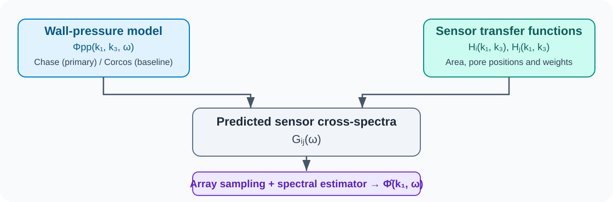
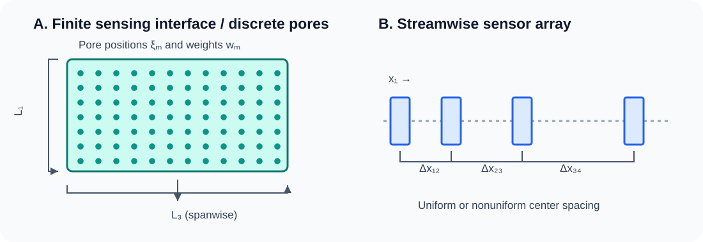
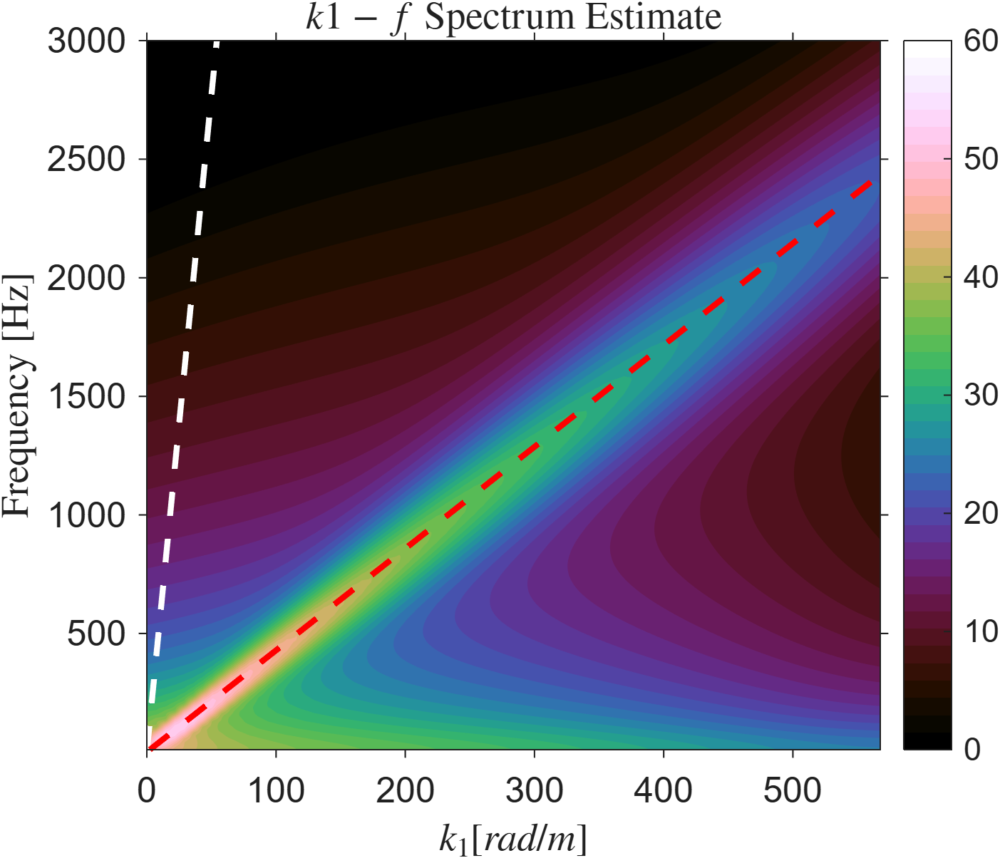
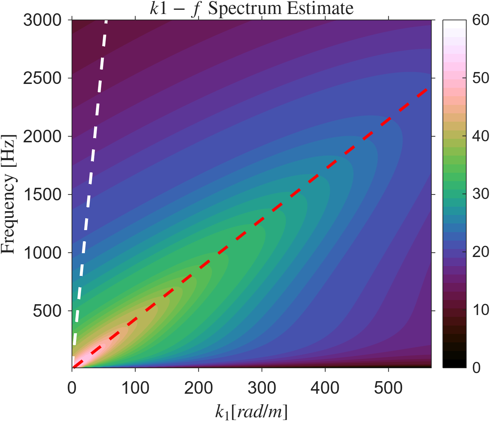
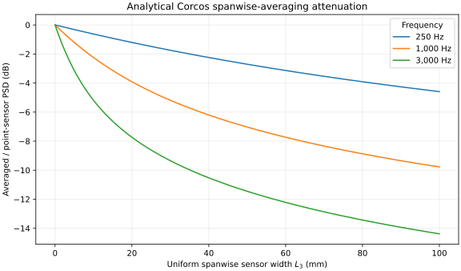

# Wall-Pressure Array Modeling and Spectral Prediction

**Forward prediction of wall-pressure cross-spectra and wavenumber–frequency spectra measured by discrete-pore, finite-area sensor arrays.**

The repository contains MATLAB implementations of four turbulent-boundary-layer wall-pressure models—**incompressible Chase**, **Corcos**, **Modified Corcos** (Hwang–Hambric), and **Smol’yakov**—evaluated through an array of spatially averaging sensors. Its principal application is the assessment of how sensor geometry and array sampling affect estimates in the weak **sub-convective** region of a wall-pressure wavenumber–frequency spectrum. The primary research reference is [Damani et al. (2025), *Journal of Fluid Mechanics*, 1014, A26](https://doi.org/10.1017/jfm.2025.10313), with [associated experimental data (Virginia Tech Data Repository, version 2)](https://doi.org/10.7294/28395098.v2). The earlier [Damani et al. (2024) modeling paper](https://doi.org/10.2514/6.2024-3048) provides additional details on the discrete-pore method.

The default example represents **80 sensors** arranged in a uniform streamwise line with **5.5 mm** center spacing. Each sensor contains a grid of **80 discrete pores** over a nominal **5 mm streamwise × 50 mm spanwise** interface. These are *example parameters*, not a requirement of the method.



> **Scope.** The scripts predict the *spatial response* of the sensing interface and array using modeled point-pressure correlations. They do not simulate the cavity/microphone acoustic transfer function, perform an experimental calibration, or independently validate the selected wall-pressure model. The Chase and Corcos maps below are supplied model outputs; they are not new experimental validation.

## 1. Why spatial averaging and array geometry matter

A turbulent boundary-layer wall-pressure field is dominated by pressure fluctuations convecting at a speed $U_c$. Much weaker contributions occur away from this convective ridge, including the sub-convective region. A sensor array does not observe the pointwise field directly: **each finite-area sensor filters pressure spatially**, and **sampling/windowing of the array further shapes the reconstructed spectrum**. Both effects must be modeled when assessing whether the weak components can be resolved without contamination from stronger convective pressure fluctuations.

The method is a **forward model**: prescribe the pressure field and sensor-array geometry, predict the measured cross-spectra, and construct the apparent $k_1$–frequency spectrum using the same spatial processing as the array model.

## 2. Measurement model: finite spatial sensitivity

Let $x_1$ denote streamwise and $x_3$ spanwise position. For sensor $i$ centered at $\mathbf{y}_i$, a spatially averaged measurement is

$$
p_i(t)=\iint g_i(\boldsymbol{\xi})\,p(\mathbf{y}_i+\boldsymbol{\xi},t)\,\mathrm{d}^2\boldsymbol{\xi},
\qquad \iint g_i(\boldsymbol{\xi})\,\mathrm{d}^2\boldsymbol{\xi}=1.
$$

Here $g_i$ is the local spatial-sensitivity function. With a statistically homogeneous pressure field, the sensor cross-spectrum can be determined from its point-pressure counterpart $G_{pp}(\Delta\mathbf{x},\omega)$:

$$
G_{ij}(\omega)=\iint\iint g_i(\boldsymbol{\xi})g_j^*(\boldsymbol{\eta})\,
G_{pp}(\mathbf{y}_i-\mathbf{y}_j+\boldsymbol{\xi}-\boldsymbol{\eta},\omega)
\,\mathrm{d}^2\boldsymbol{\xi}\,\mathrm{d}^2\boldsymbol{\eta}.
$$

This formulation is useful because the individual **pore separations**, rather than an ideal continuous sensor surface, can be inserted directly. The sign of the spatial lag and any complex conjugation must remain consistent with the adopted cross-spectrum convention; the above convention matches the positive convective-phase form used in these implementations.

### Discrete-pore approximation

The example sensors are represented by point-like pores at $`\boldsymbol{\xi}_{im}`$, with normalized real-valued sensitivity weights $`w_{im}`$:

$$
g_i(\boldsymbol{\xi})=\sum_{m=1}^{N_i}w_{im}\,\delta(\boldsymbol{\xi}-\boldsymbol{\xi}_{im}),
\qquad \sum_m w_{im}=1.
$$

Substitution into the spatial integral gives the **pore-pair summation implemented in all four scripts**:

$$
\boxed{G_{ij}(\omega)=\sum_{m=1}^{N_i}\sum_{n=1}^{N_j}
 w_{im}w_{jn}^{*}\,
G_{pp}(\mathbf{y}_i-\mathbf{y}_j+\boldsymbol{\xi}_{im}-\boldsymbol{\xi}_{jn},\omega)}.
$$

Each model supplies its own $G_{pp}$; the pore-pair summation and array processing are otherwise similar. The example code uses **uniform weights** (`Sn`, `Sm`). Finite pore diameter is not separately resolved: pores are treated as discrete sensitivity points. The finite-area formulation and application are discussed in the [2025 JFM paper](https://doi.org/10.1017/jfm.2025.10313), with complementary derivation in the [2024 modeling paper](https://doi.org/10.2514/6.2024-3048).



## 3. Choice of wall-pressure model

The repository includes four **alternative prescriptions for the point-pressure cross-spectrum**, not four independently different array estimators:

| MATLAB entry script | Model | Why use it? |
| --- | --- | --- |
| [`ChaseArrayPrediction.m`](ChaseArrayPrediction.m) | Incompressible Chase | **Primary model** for assessing the predicted spectrum, including energy away from the convective ridge. |
| [`CorcosArrayPrediction.m`](CorcosArrayPrediction.m) | Corcos-type exponential spatial decorrelation + Goody autospectrum | Simple separation-domain baseline; convenient for understanding sensor filtering. |
| [`ModCorcosArrayPrediction.m`](ModCorcosArrayPrediction.m) | Modified Corcos (Hwang–Hambric) + Goody autospectrum | Introduces an additional separation-dependent factor into the streamwise correlation. |
| [`SmolyakovArrayPrediction.m`](SmolyakovArrayPrediction.m) | Smol’yakov-type correlation + Goody autospectrum | Alternative representation with additional coherence structure. |

The Corcos, Modified Corcos, and Smolyakov implementations use a **Goody-model point autospectrum** for their amplitude scaling. The Chase script has its own model-dependent amplitude and spatial structure. Numerical parameter choices in the scripts are examples, and users should assess their suitability for their own boundary-layer conditions. In particular, `CorcosArrayPrediction.m` defaults to `a1 = 0.3275`, not the often-quoted $0.1$ baseline value; `a3 = 0.77` is used in the example. Keep the model label distinct from the chosen parameter values.

### Example predictions: Chase and Corcos

The following $k_1$–frequency maps were provided from the MATLAB model results for the example **80-sensor array** with nominal **5 mm streamwise × 50 mm spanwise sensing interfaces**. Both plots show frequency against streamwise wavenumber with the **red dashed convective line** ($k_c=2\pi f/U_c$) and **white dashed acoustic line** ($k_a=2\pi f/c_0$). The figures illustrate the predicted spectral distribution for the chosen model and array configuration; they are not independently benchmarked here against experimental data. Color scales follow the original MATLAB exports.

| Incompressible Chase (primary) | Corcos (baseline) |
| :---: | :---: |
|  |  |

The Chase result has a **broader distribution away from the convective ridge**, while the Corcos example has stronger concentration around that ridge. Interpreting sub-convective prediction requires consideration of the underlying model and the finite-aperture array response. For quantitative comparison, ensure matching flow conditions, geometric configuration, normalization, and color limits.

### A simple Corcos example

With $\omega=2\pi f$, a point-pressure Corcos-type cross-spectrum takes the form

$$
G_{pp}(\Delta x_1,\Delta x_3,\omega)
=G_{pp}(0,0,\omega)
\exp\left[-\alpha_1\frac{\omega|\Delta x_1|}{U_c}
                 -\alpha_3\frac{\omega|\Delta x_3|}{U_c}\right]
\exp\left(i\frac{\omega\Delta x_1}{U_c}\right).
$$

The exponential magnitudes control decorrelation while the complex phase represents convection. The **Modified Corcos implementation** multiplies this expression by $\left(1+\alpha_1\omega|\Delta x_1|/U_c\right)$; the actual implementation is in the corresponding script. The **Chase** and **Smolyakov** point cross-spectra are more involved, so the equations are not duplicated here; consult the local model functions at the foot of their scripts and the cited publications.

## 4. From pore cross-spectra to a $k_1$–frequency estimate

All four scripts follow the same sequence:

1. **Set flow properties:** temperature, atmospheric pressure, $U_e$, $u_\tau$, $\delta$, $\delta^*$ and $U_c/U_e$. The supplied helper functions compute air density, sound speed and dynamic viscosity.
2. **Define sensor sensitivity:** nominal $L_1,L_3$, pore coordinates `z1`, `z3`, and weights `Sn`, `Sm`.
3. **Define the array:** sensor centroids `y1`, `y3`, and the unique separations `dyu` to be evaluated.
4. **Evaluate each spatial CSD:** use the chosen model's `*Cpp_Point` inside `*Cpp_Sensor` to sum over pore pairs.
5. **Form the separation sequence:** average duplicate streamwise separations, construct negative lags by conjugate symmetry, and apply a periodic Hann (`hanning`) spatial window.
6. **Transform in space:** FFT over streamwise separation gives a model-predicted estimate $\widehat\Phi_{pp}(k_1,f)$ for the chosen finite array and processing assumptions.

The spatial FFT may be summarized schematically as

$$
\widehat\Phi_{pp}(k_1,f)\propto
\mathcal{F}_{\Delta x_1\to k_1}\left[
W(\Delta x_1)\,G_{\mathrm{array}}(\Delta x_1,f)\right],
$$

where $W$ represents the array window. **Proportionality is intentional**: absolute normalization depends on the script's transform convention and whether its intermediate cross-spectrum is dimensional or nondimensional. The supplied scripts perform the conversion and scaling explicitly; compare *like for like* before interpreting levels in dB. Their plotted spectra use magnitude (`abs`) and therefore do not show the sign of a possibly negative numerical estimate.

The codes generate: an **area-averaged autospectrum**, a **CSD versus separation and frequency**, a **$k_1$–frequency map** with acoustic and convective reference lines, and **fixed-frequency/fixed-wavenumber slices**. These figures are MATLAB outputs; they have not been independently executed as part of this documentation update.

### Resolution and sensitivity are distinct

Sensor width determines the **finite-area spatial filter**, whereas the streamwise pitch and aperture affect **sampling/aliasing and $k_1$ resolution**. The spatial window suppresses sidelobes but alters the effective response. A convincing assessment of sub-convective performance should consider (i) attenuation of the target signal, (ii) leakage from the energetic convective ridge, and (iii) resolution/aliasing from the array.

## 5. Uniform-width spanwise averaging: useful analytical check

For an *ideal uniformly sensitive* sensor of negligible streamwise length and spanwise width $L_3$,

$$
H_3(k_3)=\frac{1}{L_3}\int_{-L_3/2}^{L_3/2}e^{ik_3x_3}\,\mathrm{d}x_3
=\mathrm{sinc}\left(\frac{k_3L_3}{2}\right),\qquad
\mathrm{sinc}(z)=\frac{\sin (z)}{z}.
$$

Consequently, for a homogeneous pressure field, the **spanwise-averaged streamwise wavenumber–frequency spectrum** is (under the stated spatial Fourier normalization)

$$
\Phi_{\mathrm{avg}}(k_1,\omega;L_3)=\frac{1}{2\pi}
\int_{-\infty}^{\infty}\Phi_{pp}(k_1,k_3,\omega)
\left|\mathrm{sinc}\left(\frac{k_3L_3}{2}\right)\right|^2\mathrm{d}k_3.
$$

For an exponential Corcos spanwise covariance, let $\beta=\alpha_3\omega/U_c$ and $a=\beta L_3$. The **area-averaged/point autospectral ratio** is available directly from the double spatial average:

$$
\boxed{\frac{G_{\mathrm{avg}}(0,\omega)}{G_{pp}(0,\omega)}
=\frac{2}{a^2}\left(a-1+e^{-a}\right),\qquad a=\frac{\alpha_3\omega L_3}{U_c},}
$$

with the continuous limit $1$ when $a\to 0$. This is an **autospectral attenuation** check; it does **not** by itself quantify the array's ability to resolve sub-convective wavenumbers. Use the complete CSD/array spectrum to evaluate that question.



**Note:** Analytical illustration evaluated using a convection velocity of $U_c = 26.96$ m/s and a spanwise Corcos decay coefficient of $\alpha_3 = 0.77$. This figure is not generated by the MATLAB array-model scripts and does not represent a Chase-model prediction.

## 6. Running the MATLAB examples

**Requirements.** MATLAB with support for scripts containing local functions. Place all `.m` files in the same folder (or on the MATLAB path). All four scripts call `AirDensityCalc.m`, `AirSpeedOfSoundCalc.m`, and `AirViscosityCalc.m`. They also invoke [`cubehelix`](https://www.mathworks.com/matlabcentral/fileexchange/43700-cubehelix-colormap-generator-beautiful-and-versatile) for plotting, which is **not included** in this repository; install it or substitute a built-in colormap. The scripts invoke `hanning`, whose availability may depend on your MATLAB toolboxes/version. No verified minimum MATLAB release is claimed here.

From the repository directory, run a model script, for example:

```matlab
ChaseArrayPrediction
% Or: CorcosArrayPrediction
% Or: ModCorcosArrayPrediction
% Or: SmolyakovArrayPrediction
```

The scripts calculate and plot results interactively; they do not automatically save output files. The largest computational expense is repeated summation over **pore pairs × sensor separations × frequencies**. Changing sensor count, number of pores, or frequency discretization can significantly affect runtime.

### Where to edit the example

| Quantity | Variables in each model script | Default example |
| --- | --- | --- |
| Ambient conditions | `Temp`, `Patm` | 83 °F; 27.88 inHg |
| Flow parameters | `Uinfty`, `Ue`, `utau`, `delta`, `deltas`, `Uc_Ue` | 38.19 m/s; 38.51 m/s; 1.342 m/s; 66.3 mm; 9.6 mm; 0.7 |
| Frequency range | `freq` | 10–3000 Hz, 500 points |
| Sensor interface | `L1`, `L3`, `z1`, `z3` | 5 mm × 50 mm; 4 × 20 pores |
| Spatial sensitivity | `Sn`, `Sm` | Equal normalized weights |
| Sensor centroids | `y1`, `y3` | 80 sensors; 5.5 mm pitch; zero spanwise offset |
| Corcos-family decorrelation | `a1`, `a3` | 0.3275; 0.77 |

In these scripts `z1,z3` are **pore coordinates relative to the sensor centroid** and `y1,y3` are **sensor centroid coordinates**. A change to `L1` or `L3` **alone does not redistribute the pores**; update `z1` and `z3` consistently. Nonuniform arrays may require changes beyond replacing `y1`: the downstream reconstruction currently assumes regularly sampled streamwise separations for the FFT. The model implementations use a constant `Uc_Ue` by default; frequency-dependent convection speed requires additional modifications.

### Repository files

| File | Role |
| --- | --- |
| `ChaseArrayPrediction.m` | Chase point-pressure CSD, pore summation, and streamwise wavenumber reconstruction |
| `CorcosArrayPrediction.m` | Corcos point-pressure CSD with Goody autospectrum and same array pipeline |
| `ModCorcosArrayPrediction.m` | Modified Corcos point-pressure CSD with Goody autospectrum |
| `SmolyakovArrayPrediction.m` | Smol’yakov point-pressure CSD with Goody autospectrum |
| `AirDensityCalc.m` | Air density for specified pressure and temperature |
| `AirSpeedOfSoundCalc.m` | Ideal-gas speed of sound for specified temperature |
| `AirViscosityCalc.m` | Dynamic viscosity using a temperature-based relationship |
| `figures/` | Workflow and sensor schematics, analytical averaging illustration, and Chase/Corcos spectral examples |
| `License.txt` | MIT License |

## 7. Interpretation, limitations, and checks

- **Spatial model versus hardware response:** discrete weighting approximates the sensing interface; the cavity, microphone and electronics response are not explicitly represented.
- **Homogeneity:** the conversion from spatial cross-correlation to a wavenumber spectrum presumes a statistically homogeneous field. Do not automatically extend it to a strongly inhomogeneous boundary layer.
- **Point-pore approximation:** individual pores are modeled as sample points, not as independently resolved finite circular apertures.
- **Pore weights:** uniform weights are assumed; measured nonuniform sensitivity should be inserted if available.
- **Spectral estimation:** finite aperture, spatial window, conjugate-lag completion, numerical resolution and normalization can affect predicted sub-convective levels. A low-wavenumber feature alone is not proof of a physical source.
- **Before publication or benchmarking:** check pore-weight sums, Hermitian symmetry of the assembled CSD, point-sensor/zero-width limits, units (Hz versus rad/s), and sensitivity to window and grid choices.

## 8. References, data, and citation

**Primary article and supporting dataset**

- Damani, S., Butt, H., Totten, E., Devenport, W. J. & Lowe, T. (2025). [*Measurement and analysis of sub-convective wall pressure fluctuations in turbulent boundary layer flows*](https://doi.org/10.1017/jfm.2025.10313). *Journal of Fluid Mechanics*, **1014**, A26.
- [Experimental dataset associated with the JFM article (Virginia Tech Data Repository), DOI:10.7294/28395098.v2](https://doi.org/10.7294/28395098.v2)

**Earlier methodology and related work**

- [Damani et al., *The Characteristics of Sub-Convective Wall Pressure Fluctuations in a Turbulent Boundary Layer* (2024)](https://arc.aiaa.org/doi/abs/10.2514/6.2024-1904)
- [Damani et al., *Evaluating Models for Sub-Convective Pressure Fluctuations in Turbulent Boundary Layers* (2024)](https://arc.aiaa.org/doi/abs/10.2514/6.2024-3048) — see Section V for mathematical methodology.
- [*Measurement and Analysis of Sub-Convective Pressure Fluctuations in Turbulent Boundary Layers: A Novel Methodology* (dissertation)](https://vtechworks.lib.vt.edu/items/d3a198f2-1437-46fb-959f-310f25084c21)

**Underlying models**

- [Corcos model](https://www.sciencedirect.com/science/article/abs/pii/0022460X67901587)
- [Modified Corcos / Hwang and Hambric](https://apps.dtic.mil/sti/citations/ADA465806)
- [Smol’yakov model](https://link.springer.com/article/10.1134/S1063771006030146)
- [Incompressible Chase model](https://www.sciencedirect.com/science/article/abs/pii/0022460X80905532)
- [Goody model](https://arc.aiaa.org/doi/10.2514/1.9433)

**License:** MIT; see [`License.txt`](License.txt). When using this repository in research, please cite the primary JFM paper and the applicable underlying wall-pressure model(s). The earlier methods papers offer additional derivation.
